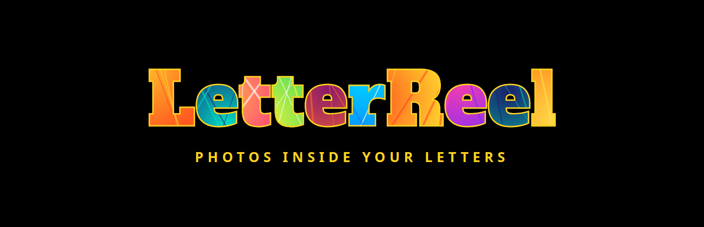

# LetterReel

A WordPress block that shows a different photo through each letter of a big word or title, with a gentle entrance animation. The word always fits on one line.



- **Block:** `letterreel/letters` ("LetterReel Letters", Design category)
- **Requires:** WordPress 6.5+, PHP 7.4+
- **Licence:** GPL-2.0-or-later. The bundled Alfa Slab One font is SIL OFL 1.1 (`fonts/OFL.txt`).

## How it works

- `block/block.json` registers the block (API version 3). It is a dynamic block: `block/render.php` builds the markup.
- Each letter is a `span` with the photo as its background, clipped to the text (`background-clip: text`). Screen readers get the whole word from a visually hidden copy; the letters are `aria-hidden`.
- Fitting: the server estimates the word's width in em (`--letterreel-w`) from the font's real letter widths (`includes/font-widths.php`, generated from the font files), and the CSS sizes the text with container query units: `min(max size, 94cqi / width)`. `block/view.js` measures the exact width once fonts load, which is what makes the theme-font option fit.
- The editor (`block/index.js`) is plain JavaScript using the `wp.*` globals: no build step. `*.asset.php` list its dependencies.

## Develop

Edit the files in place; there is nothing to compile.

```sh
bin/build-zip.sh        # dist/jmabry111-letterreel.zip, without the files listed in .distignore
```

`.wordpress-org/` holds the directory banner, icon and screenshots (they go in the SVN `assets/` folder, not the zip).

## Release to WordPress.org

1. Bump the version in `jmabry111-letterreel.php` (header and `LETTERREEL_VERSION`), `block/block.json`, both `*.asset.php`, and `Stable tag` + changelog in `readme.txt`.
2. Run Plugin Check (Tools > Plugin Check) with every category ticked.
3. `bin/build-zip.sh`, then copy into SVN `trunk/`, tag it, and commit.
